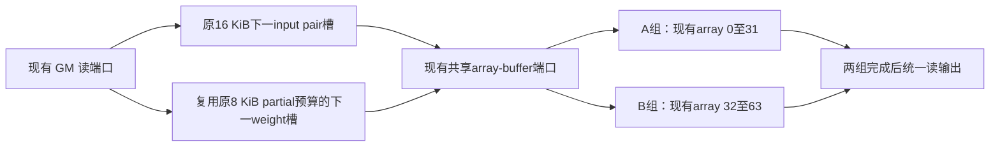

# 读取、编程、计算重叠：实现与端到端实验

本轮在退役32-array weight-stationary后的64-array、单operand context、output retention路径上实现受限的软件流水。六个正式对照全部通过：读取流水有收益；两组阵列错开没有额外净收益。建议开启输入与本地权重预取，保持array_groups=1。

## 正式端到端结果

单位为CPU cycles；收益均相对同库、同输入的baseline。

| S | 方案 | Projection含Norm | 交接 | Attention | E2E | E2E下降 |
|---:|---|---:|---:|---:|---:|---:|
| 1024 | baseline | 416,538 | 2,019 | 155,215 | 573,772 | — |
| 1024 | 输入＋本地权重读取流水 | 389,379 | 1,604 | 153,948 | **544,931** | **5.03%** |
| 1024 | 读取流水＋两组阵列 | 389,395 | 2,081 | 155,109 | 546,585 | 4.74% |
| 2048 | baseline | 801,164 | 3,794 | 549,932 | 1,354,890 | — |
| 2048 | 输入＋本地权重读取流水 | 750,207 | 3,193 | 550,666 | **1,304,066** | **3.75%** |
| 2048 | 读取流水＋两组阵列 | 751,200 | 3,188 | 550,656 | 1,305,044 | 3.68% |

读取流水分别省28,841/50,824 cycles，Projection下降6.52%/6.36%。两组阵列相对读取流水反而增加1,654/978 E2E cycles；S1024的Projection只差16 cycles，几乎持平，E2E差异主要在交接与后续Attention时序。Attention的输入、算法与配置相同，但更早的启动改变了共享存储访问时序，因此以实测完整E2E为准。

乐观计算参考仍为268,592/799,328；最佳方案的实际/参考比值从2.136/1.695降至2.029/1.631，仅消除了原差距的9.45%/9.15%，还远未消除整体搬运和调度开销。

机器汇总见 [projection_overlap_results.json](projection_overlap_results.json)，正式完整artifacts在`results/projection_overlap_20261011/formal_v1/`；构建、测试和本轮源码diff在其上级`validation_logs/`。

## 为什么收益有限

下表取各方案自身最后完成的Projection worker，worker可能变化；前台读和wait是状态驻留时间，并非独立可相加的节省量。

| S | 方案/关键worker | 前台Local GM read | load_weight阶段 | 等下一weight快照 |
|---:|---|---:|---:|---:|
| 1024 | baseline/core16 | 112,032 | 13,628 | 0 |
| 1024 | reads/core18 | 32,508 | 55,260 | 10,893 |
| 1024 | groups/core16 | 44,405 | 77,161 | 8,179 |
| 2048 | baseline/core16 | 224,064 | 26,431 | 0 |
| 2048 | reads/core16 | 64,116 | 112,906 | 22,462 |
| 2048 | groups/core16 | 91,382 | 158,179 | 14,012 |

读取预取确实把搬运移入MAC期间：reads关键worker的GM/compute驻留重叠为56,044/111,723 cycles。然而消费者更快后，上游权重供给等待暴露出来；HBM预取命中表示进入过预取路径，并不表示消费时已ready。现有`weightPrefetchBusy_`仍将同head的预取限制为一次一个DMA；下一head首weight仍走需求路径。统计支持“权重供给成为更大瓶颈”，具体优化仍需按提交、落地、消费时间验证。

分组确实实现编程与另一组MAC重叠：关键worker的buffer/compute驻留交集为111,598/221,137 cycles。但每份weight现在要经共享array-buffer端口广播两次。S1024每worker的矩阵请求1,536→3,072，ingress12→24 MiB，matrix端口服务59,904→116,736 cycles；sink总bytes不变。含input/output的端口服务112,176→170,544 cycles，S2048全部翻倍。新增服务以及更大的weight-ready等待抵消重叠收益，所以不建议默认开启分组。

## 数据流变化

- 输入：64-array路径启动偶数hidden tile的MAC后，使用原有16 KiB future-input槽读取下一对tile；当前pair保留至奇数tile消费完，再交付下一pair。原来该路径有槽但不会启动预取。
- 权重：HBM→GM缓存仍用原有lookahead；增加GM→下一weight快照的后台读取。它占用retention模式原本闲置的8 KiB future-partial预算，不扩大staging。一个槽必须消费后才能重新使用，绝对weight tile标签避免跨head错配。
- 编程：现有64阵列固定分为A/B两组，各32个阵列、各负责原64行中的32行。A计算时可以向B广播权重、scatter输入；只有A完成自己的MAC后，才允许重新编程A。每个阵列始终只有一套operand和原有输出累加器。两组独立累加完整hidden维度，最后一起读64行输出，不spill/restore partial。



GM单个读端口仍按原服务模型串行处理请求；不同资源之间可以重叠。共享array-buffer端口也保留原仲裁。分组需要两次matrix broadcast，真实请求、传输bytes、端口占用和启动开销均计费。因此重叠存在不保证净收益，必须看完整E2E。

## 实验约束与验证

正式形状为Hq32/Hkv8/D64/hidden2048、S1024/S2048、causal+RoPE；计时范围RMSNorm→QKV→RoPE→Attention→O，未包含Wo/residual/MLP。16个worker各64阵列；manager只有控制功能；每阵列1份matrix/input context。GM为2 MiB/worker，256 B/cycle、base latency1、1读/1写端口、4096 B请求上限、queue256。future input16 KiB+future weight8 KiB+output8 KiB仍为原32 KiB预算。

baseline、reads、groups用同一源码/库/guest二进制和输入SHA256；逐MPI rank保存日志。baseline复现旧正式结果573,772/1,354,890 cycles；所有新case必须通过独立NumPy数值、HBM逐字节、资源拓扑和请求/bytes对账。

已完成正确性检查：140项Attention单元测试、23项baseline测试、7项原路径回归全部通过。小形状Hq4/Hkv2/hidden256的input/reads/groups/groups_only均通过；慢GM三组（64 B/cycle、base3、queue64）通过；S3072非融合、未打包输入的三组通过。分组时序核对同一组上次done不晚于下次program，并确认另一组program与MAC有实际交集。S3072验证3,072次tile-group生命周期，没有同operand冲突。

极小queue2测试的未优化对照在Projection成功后，于既有Attention RoPE表批量读路径失败。该路径队列拒绝后直接失败，没有重试。本轮未改动此独立问题；不能声称queue2完整E2E已通过。详见`results/projection_overlap_20261011/validation_logs/slow_queue2_limitation.md`。

## 使用与复现

三个新选项默认分别0、0、1，原路径继续可用。开启需要64 arrays、retained output、pipeline、shared input、row_first=0。

```bash
GOLEM_PROJECTION_INPUT_PAIR_PREFETCH=1
GOLEM_PROJECTION_LOCAL_WEIGHT_PREFETCH=1
GOLEM_PROJECTION_ARRAY_GROUPS=1
```

上述配置是本轮推荐的读取流水。将最后一项改为2可复现分组实验；正式结果未证明它优于1，因此默认保持1。

受控完整对照命令：

```bash
python3 baseline/attention_cluster_8qk_8pv/run_projection_overlap.py \
  --stage formal --variants baseline reads groups \
  --artifact-root results/projection_overlap_new \
  --reference-root results/retired_ws_final_verified
python3 baseline/attention_cluster_8qk_8pv/analyze_projection_overlap.py \
  --artifact-root results/projection_overlap_new \
  --output results/projection_overlap_new/analysis.json
```

## 尚未解决的串行点

本轮不改变worker release、Norm→Projection先后顺序或Projection→Attention整阶段屏障。也没有给同一个阵列添加第二份operand以并行编程与计算。已有HBM→GM权重预取仍只有一个在途DMA，且不跨head；当本地读取被隐藏后，消费者更快，可能提前撞上尚未到达的权重。需要用新关键路径重新排序后续优化，不能把前台GM read下降当成同等E2E下降。

后续优先验证这个单在途软件限制：记录DMA submit/landing/consume，在已有缓存槽和原DMA outstanding额度内尝试更早提交、受限多请求与跨head预取；不增加缓存或通道。约30k worker启动差仍未变化，集中release也是独立候选。之后再评估Norm producer/Projection consumer与Attention阶段交接，不能把这些尚未实施的方案算入本轮收益。

分组模式的compute_busy_cycles表示至少一个组忙的时间，不能与整64阵列同时忙的时间直接比较为利用率；MAC总工作未减少。buffer_compute_overlap_cycles/gm_compute_overlap_cycles是请求驻留与计算重叠的诊断，不是纯端口服务量，不能再与phase cycles相加。
