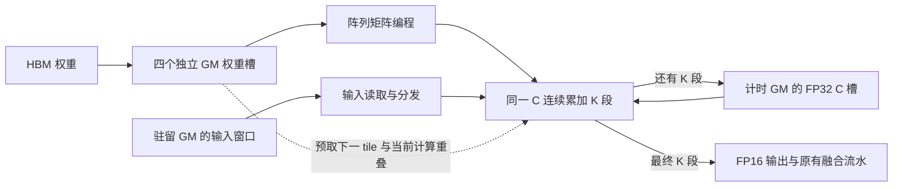

# All-GEMM reuse-window 流水修复

修改仅位于 `Muticore-Attention-all-gemm` 独立工作树。原始
`Muticore-Attention` 的源代码、安装库和历史结果保留。

## 调度与资源约束

- QKV、Wo、Gate、Up、Down 采用四个 N tile 的 GM 输入窗口；每个 N
  连续完成一段 K 累加，随后才切换输出上下文。支持 K=4/8/16/32。
- Decoder 的窗口直接引用已经驻留 GM 的输入或 gated panel，不重复复制输入。
  QKV 的 packed 输入仍通过实际 GM 读写整理到窗口中。
- C 在整个 K 累加段内驻留于物理阵列。跨 K 段的 C 使用四个 FP32 GM 槽，
  所有保存和恢复均经过计时端口。最终输出采用 FP16 阵列读出；Down 跨融合
  panel 的原有 FP16 舍入边界保留。
- 权重使用四个独立的 8 KiB GM 槽，DMA 和 GM 读取独立于计算流推进。
  当前 tile 的输入 GM 读取与矩阵编程重叠。
- 64 个阵列可分为 32+32 两组交错执行；只在该子组的全部 MAC 回调完成后
  才允许重新编程。没有增加阵列、operand bank、端口或 HBM 带宽。
- LM head 恢复四个独立阵列上的 N 并行，输入共享，各阵列连续持有自己的
  C 上下文直到所有 K 完成。QK/PV 保留 attention 专用 reuse-window 路径。
- 原有 FFN panel、SFU、Down、残差和输出 DMA 生命周期继续推进。移除了
  新调度器的固定 256-cycle 恢复等待，使用生产者/存储端口的实际 ready 事件。
- QKV 的旧权重预取器在 window 模式下停用，避免向已归 window 所有的
  `scratch+0x60000` 区域继续写入。新 window 预取队列负责该模式下的权重搬运。

这里的四 N 输入复用位于 **GM 层**。阵列输入仍按 K/N 编程并计时，不能将其
描述为一次 A 编程服务四个 N。它以部分 A 编程复用换取 C 的连续累加。



Decoder 使用既有输入/panel 空间、`decoder_down_weight_gm` 的 32 KiB 权重槽，
以及 `decoder_prefetch_gm` 的最多 64 KiB C 槽。QKV 复用原权重缓存范围：相对
scratch 的 A=`0x60000`（最多 256 KiB）、B=`0xA0000`（32 KiB）、
C=`0xA8000`（64 KiB）。运行时检查这些窗口互不覆盖且不越过 GM 尾部保留区。

## 验证与复现

行为测试使用生产调度器，模拟 GM 拒绝重试、DMA 乱序完成、延迟 MAC 回调和
每个阵列独立的累加上下文。覆盖 M=1/33/64、N 和 K 尾块、初始 C、GM 输入
别名、K 段间 FP32 保存恢复与最终 FP16 舍入。

```bash
python3 -m unittest discover \
  -s src/sst/elements/golem/tests/small/muticore_attention \
  -p test_reuse_window_gemm.py -v

source scripts/env_local_install.sh
OPENBLAS_NUM_THREADS=1 python3 baseline/attention_cluster_8qk_8pv/run_reuse_window_micro.py \
  --artifact-root results/reuse_window_micro_example --shape formal \
  --workers 1 --mpi-ranks 1 --cpu-set 0 --with-down --with-residual \
  --prefetch-slots 4 --variants layout2 --reference-variant layout2 \
  --window-k-tiles 32 --window-array-groups 1

OPENBLAS_NUM_THREADS=1 python3 baseline/attention_cluster_8qk_8pv/run_all_gemm_reuse_window_baseline.py \
  --artifact-root results/reuse_window_stack_example --shape formal --run \
  --window-k-tiles 32 --window-array-groups 1 --cpu-set 8-15
```

正式测试固定 S=1024、H=2048、FFN=8192、两层、词表 128256、16 个 worker、
8 个 MPI rank，比较 token IDs 到最终 logits DMA ACK 的周期；同时报告两层
decoder 自身的周期。MPI rank 数量与 worker 数量不是同一概念。

原生流水对照为 `reuse_window_v2_micro_native_formal_20261020`。
`reuse_window_v2_micro_formal_k*_final_20261020` 为中间候选：数值检查通过，
但旧的 Down 恢复计数未接入而触发审计失败；它们不作为最终通过结果。
最终修复后的局部筛选使用 `reuse_window_v3_micro_formal_k*_20261020`。

正式宽度单 worker 的 FFN + Down + residual SST 筛选结果（同输入、同资源）：

| 配置 | cycles | 数值 / Down 生命周期 / 子组端口审计 |
| --- | ---: | --- |
| 原生流水 | 2,318,469.625 | PASS |
| K=4 | 3,575,273.125 | PASS |
| K=16 | 2,466,251.625 | PASS |
| K=32 | 2,342,806.625 | PASS |
| K=32，预取槽降为 1 | 4,895,529.625 | PASS |
| K=32，64 阵列单组 | 2,018,763.625 | PASS |

因此选择 K=32 做完整端到端验收，并对双子组与单组都测完整链路。局部单组更快，
因为双子组需要额外一次权重广播，其收益取决于输入准备和端口竞争；不能把原生
路径中双子组更快的结论直接套到新 window 调度。上述局部数据不能代替 16 worker
的完整测试。单组对照的实际窗口配置为 `GOLEM_REUSE_WINDOW_ARRAY_GROUPS=1`；
原生 `GOLEM_DECODER_ARRAY_GROUPS` 是独立配置，不代表 window 实际执行组数。
局部 runner 使用窗口启动次数和物理 MAC 周期审计该情况。
后续只修改了 QKV 旧预取器的 scratch 所有权保护，FFN 调度代码与这些局部测试
保持一致。保护修复前的 v3 小形状端到端测试触发原数值阈值失败，不计为通过。
保护修复后的 v4 小形状两层通过全部检查，端到端为 679,738.75 cycles；
Q/K/V panel 均逐元素一致，最后 attention 最大绝对误差 0.00006103515625，
低于原有 0.0003 阈值。

新增独立 panel 审计直接检查最后一层实际 Q/K/V panel 与 CPU 投影参考逐元素一致。
它能捕获融合模式下没有 raw Q/K/V DMA 时被隐藏的数据覆盖；不以近似 attention
输出的误差阈值替代投影本身的检查。

性能结果与执行证据在本次最终结果目录中记录。各阶段跨度可能重叠，不能相加
当作端到端延迟；worker 周期的求和也不是墙钟周期。

## 双子组完整链路验收

`results/all_gemm_reuse_window_v4_formal_l2_s1024_mpi8_20261020` 已通过全部数值、
panel、DMA ACK、生命周期和覆盖检查。端到端为 **7,463,106.75 cycles**，
相对上一版 20,120,184.75 cycles 减少约 62.91%；原始基线为 7,424,562 cycles，
因此该配置仍慢 0.52%。两层 FFN span 分别为 2,324,930 和 2,339,388 cycles。

FFN 权重预取请求/命中均为 393,216；实际子组启动 786,432；双子组同时计算的
worker-cycle 合计为 2,752,512。LM head 组启动 16,384 次，对应 64,128 个
array K tile，LM head 延迟 699,357.75 cycles。最终 token=99037。

原始基线安装库 SHA256 保持为
`a56013188b986918e8f5ea6aa64c4fbe0c8c35e48febbde791b004a4aa9febae`。
## 最终单组完整链路验收

`results/all_gemm_reuse_window_v4_formal_groups1_l2_s1024_mpi8_20261020` 全部 PASS。
端到端为 **6,858,648.75 cycles**，即 1 GHz 下约 **6.859 ms**；相对原始基线
减少 **7.62%**，相对上一版 window 减少 **65.91%**。两层 decoder 自身为
5,983,622.75 cycles，LM head 为 702,526.75 cycles。两层 FFN span 分别为
2,100,233 和 2,075,672 cycles。最终 token 仍为 99037。

因此新基线 runner 默认采用 K=32、4 个权重预取槽、每个 worker 的 64 个阵列
作为单组；LM head 独立采用原生四路 N 并行。单组仍运行所有 64 个阵列，
不减少计算工作量。局部单组/双子组的物理 MAC 均为 52,690,944 array-cycles，
但权重编程累计周期从 958,464 降至 491,520。完整链路测试验证了局部选择。

两层 FFN 的预取请求/命中均为 393,216，C 读出共 16,384 次，Down 跨 panel
恢复 7,168 次。最后一层实际 Q/K/V panel 分别检查 2,097,152、524,288 和
524,288 个元素，均无差异。所有候选与原始基线的 105 份预加载内容及 oracle
哈希相同；双子组和单组使用同一编译库和相同 C++ 源码。

`summarize_reuse_window_pipeline.py` 已汇总完成实验，检查原始库与代码未改动、
输入一致、实验库/源码一致、最终 token 一致，以及全部审计通过后，选择实测
较快的配置。完整结果位于 `results/reuse_window_pipeline_final_20261020/REPORT.md`，
机器可读结果为同目录 `comparison.json`。

生产调度器行为测试、9 项既有 decoder C++ 测试、reuse-window 开启时的 LM
并行回归均通过。最后一轮 host 回归 27 项通过，日志保存在最终结果目录
`host_regression.log`。原始数值阈值未放宽；早期 scratch 冲突候选保留失败记录。
