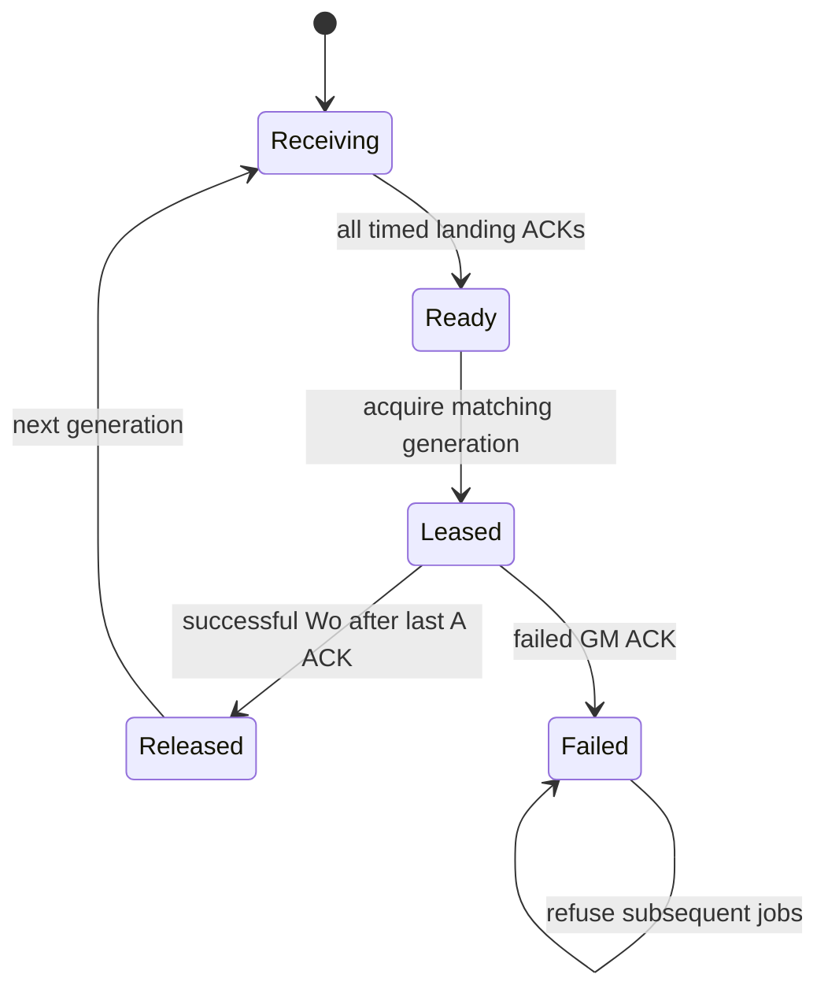

# P3 direct PV → Wo landing review

Direct mode keeps the existing S1024/H2048 PV redistribution and global Attention completion dependency. It changes only Wo's software GM addresses and consumer lifetime. Hardware resources, port timing, NoC payload charging, DMA completion semantics and arithmetic order remain unchanged.

## Live GM intervals (worker-relative, half-open)

| Owner | Interval | Direct Wo lifetime |
| --- | --- | --- |
| Four existing B slots | `[0x10000, 0x18000)` | Reuses the freed normal-input arena; no extra capacity |
| Wo output handoff | `[0x70000, 0xb0000)` | Preserved |
| Retained layer input / later Add-Norm handoff | `[0xb0000, 0xf0000)` | Preserved |
| Existing C scratch | `[0x152000, 0x162000)` | Preserved |
| PV input landing | `[0x1a0000, 0x1e0000)` | Immutable until explicit release |

The old B scratch starts at `0x1a2000`, which overlaps the input landing. Changing only the A pointer is therefore incorrect. The failing production-path test in `p3_direct_before.log` records that conflict before the fix.

## Ownership

`receiving → all timed landing ACKs → ready → acquire(epoch, manager, lane) → Wo timed A reads / GEMM / output ACKs → release → next generation`.

- A consumer can acquire exactly once. Reacquire, old consume and incoming next-generation payload are rejected while leased.
- Failed timed GM A requests retain the lease and cannot silently expose a partially consumed landing for reuse.
- Successful Wo completion releases the landing after all A read ACKs. The following FFN is allowed to reuse the original tail scratch.
- Direct mode requires the validated ReuseWindowGemm path. With direct mode disabled, the old non-window Wo loop retains its relocation fallback.

## Verification

- C++ production service: two generations × all 16 workers; delayed GM write ACKs, retry/backpressure, duplicate inputs and wrong/duplicate consumer release.
- Real DecoderOpJob with timed GM stubs: groups 1/2, poisoned HBM O, immutable landing, disjoint B DMA, zero relocation, successful release and subsequent real FFN reuse.
- Python trace audit: actual GM A read coverage, all dense B landing bytes, no overwrite, no hidden relocation writes, release after last A ACK.
- Full SST runs separately retain HBM, old handoff and direct modes. Passing local behavior tests does not establish an end-to-end speedup.

The existing production DecoderOpJob Wo → FFN test supplies the local scratch-lifetime regression. Full two-layer SST then checks Wo → Add/RMSNorm2 → FFN under the real interconnect; no separate artificial local guest is added.

The injected failed-input-ACK test exposed a pre-existing repeated completion callback in ReuseWindowGemm. Completion is now idempotent and tick stops issuing requests immediately after failure. A failed direct job keeps its input lease even after retire and refuses further jobs that could overwrite the landing. See the preserved failing and fixed ACK regression logs.

## Consumer lifecycle

Enable with `--pv-wo-gm-handoff --pv-wo-direct-input` on `run_all_gemm_reuse_window_baseline.py`.
The runner requires the formal S1024/H2048 shape. Same-build P4 direct and combined runs pass functionally and pass the traffic/lease audits, but both are slower than the HBM control; direct mode therefore remains an explicit opt-in. Final cycle results are recorded in `PROGRESS_2026-10-24.md` and `results/optimization_20261024/summary.json`.
